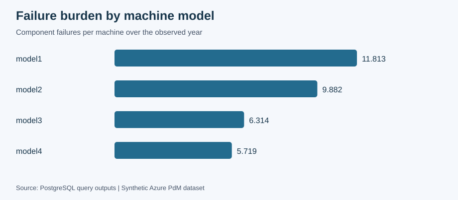
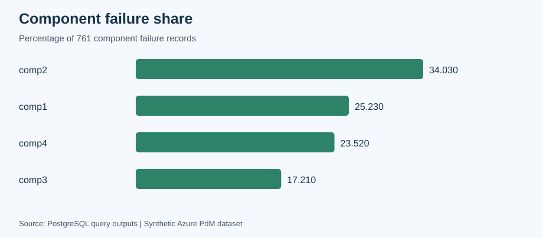
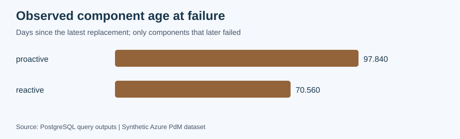

# Azure Predictive Maintenance — SQL Reliability Analytics

## Project overview

A PostgreSQL portfolio project that explores machine reliability, maintenance history, errors and sensor readings using **intermediate SQL**. The analysis uses the synthetic Microsoft Azure Predictive Maintenance dataset and keeps the calculations readable with `JOIN`, `GROUP BY`, `CASE`, subqueries, short CTEs and reusable views.

The questions are practical: which machine models have the greatest failure burden, how component age differs by replacement type, and which errors and sensor changes appear before recorded failures. All analytical calculations run in SQL.

## Verified results

| Measure | Result |
| --- | ---: |
| Machines | 100 |
| Hourly telemetry records | 876,100 |
| Error records | 3,919 |
| Maintenance records | 3,286 |
| Component failure records | 761 |
| Distinct machine failure events | 719 |
| Complete machine failure intervals | 621 |
| Fleet mean time between observed failures | 1,107.29 hours |
| Machines without recorded failures | 2 |

- **Model1** has 11.813 component failures per machine, compared with **5.719 for model4**. Fleet size changes the interpretation of raw failure counts.
- **Comp2** accounts for **34.03%** of component failure records.
- Among components that later failed, average age since the latest replacement is **97.84 days after proactive replacements** and **70.56 days after reactive replacements**. This describes observed component age, not a causal maintenance effect or a survival estimate.
- Error5 before comp4 has **101.38× lift** relative to the fleet daily error baseline. Including errors at the exact failure timestamp changes the 24-hour count from **1,177 to 1,181**.
- Mean sensor changes before failure are component specific: comp1 voltage **+11.76%**, comp2 rotation **−17.39%**, comp3 pressure **+23.90%**, and comp4 vibration **+24.42%**, relative to each machine’s full-period mean.

Selected results are in [reports/results/](reports/results/). The [static HTML report](reports/azure_pdm_sql_analysis.html) contains all exported tables; download or clone the repository and open the HTML file locally to view the rendered report.

## Portfolio visuals







## Method and SQL level

1. Create five related tables with primary keys, foreign keys and value checks.
2. Load CSV files in a single transaction and compare row counts with the source.
3. Check NULLs, duplicates, orphan machine IDs, timestamps, hourly coverage and sensor ranges.
4. Compare fleet composition and failures per machine by model and age group.
5. Find the previous failure with a correlated `MAX` subquery and calculate observed MTBF.
6. Classify maintenance using a left join and find the latest earlier component replacement.
7. Count leading errors with `CASE` and compare their rates with a fleet baseline.
8. Compare pre-failure sensor means with full-period means using percentage changes.
9. Join independent machine summaries into a reusable KPI view and calculate an illustrative priority score.

The scripts use short, named stages. They avoid `LATERAL`, window functions, arrays, ordered-set percentile aggregates and procedural SQL. The moving-average example uses a time-range self join for **machine 1**; edit the filter to inspect another machine. The first 23 observations have shorter history, shown by `readings_in_window`.

The top-machine query returns exactly ten rows, with `machine_id` resolving equal counts. Component shares replace cumulative Pareto percentages. Priority groups use visible score thresholds rather than fleet quartiles. Sensor percentage changes replace standardized shifts; these are different metrics.

## Reproducibility

Requirements: **Docker**, a running Docker engine and **PowerShell** for the commands below. PostgreSQL 16 provides the SQL runtime and `psql` client inside the container. There are no Python packages or notebook dependencies.

Download the five CSV files into `raw_data/` following [raw_data/README.md](raw_data/README.md). From the repository root:

```powershell
docker run --name azure-pdm-sql `
  -e POSTGRES_PASSWORD=postgres `
  -e POSTGRES_DB=azure_pdm `
  -p 55433:5432 `
  -v "${PWD}/raw_data:/data:ro" `
  -v "${PWD}/sql:/sql:ro" `
  -v "${PWD}/reports:/reports" `
  -d postgres:16

# Wait until PostgreSQL accepts connections.
do {
  docker exec azure-pdm-sql pg_isready -U postgres -d azure_pdm
  $ready = $LASTEXITCODE -eq 0
  if (-not $ready) { Start-Sleep -Seconds 1 }
} until ($ready)

$files = @(
  '00_schemas.sql', '01_load_data.sql', '02_data_quality.sql',
  '03_fleet_overview.sql', '04_reliability_kpis.sql',
  '05_maintenance_effectiveness.sql', '06_error_leading_indicators.sql',
  '07_telemetry_behaviour.sql', '08_kpi_views.sql', '09_export_results.sql'
)
foreach ($file in $files) {
  docker exec azure-pdm-sql psql `
    -v ON_ERROR_STOP=1 -U postgres -d azure_pdm -f "/sql/$file"
  if ($LASTEXITCODE -ne 0) { throw "SQL failed: $file" }
}
```

Use a **dedicated project database**: `00_schemas.sql` recreates the five project tables and dependent views, and `01_load_data.sql` reloads their data. Running the sequence again rebuilds the same analysis. CSV exports are regenerated by `09_export_results.sql`; the HTML report and figures are committed snapshots of the verified source dataset, rather than automatically refreshed exports.

For DataGrip, connect to `localhost:55433`, database `azure_pdm`, user/password `postgres`, and run **00–08 in order**. These files contain regular PostgreSQL SQL. `COPY` reads paths available to the **database server**, so a local installation needs the five absolute file paths edited. [PostgreSQL COPY documentation](https://www.postgresql.org/docs/16/sql-copy.html) explains server file access. Run **09 through `psql`** because `\copy` is a client command; for a local client, replace `/reports/results/` with the local output directory.

## Analysis files

| File | Purpose |
| --- | --- |
| [00_schemas.sql](sql/00_schemas.sql) | Table structure and constraints |
| [01_load_data.sql](sql/01_load_data.sql) | Atomic CSV load and source count comparison |
| [02_data_quality.sql](sql/02_data_quality.sql) | NULLs, duplicates, coverage, orphan IDs and ranges |
| [03_fleet_overview.sql](sql/03_fleet_overview.sql) | Fleet mix, normalized failure burden and component shares |
| [04_reliability_kpis.sql](sql/04_reliability_kpis.sql) | Machine/component MTBF, failure-free machines and monthly trends |
| [05_maintenance_effectiveness.sql](sql/05_maintenance_effectiveness.sql) | Maintenance classification and observed component age |
| [06_error_leading_indicators.sql](sql/06_error_leading_indicators.sql) | Leading windows, baseline error rates and lift |
| [07_telemetry_behaviour.sql](sql/07_telemetry_behaviour.sql) | Daily means, moving-average example and percentage changes |
| [08_kpi_views.sql](sql/08_kpi_views.sql) | Machine summary, priority score and count validation |
| [09_export_results.sql](sql/09_export_results.sql) | Reproduce selected CSV outputs with `psql` |

## Definitions and validation

- Telemetry covers **2015-01-01 06:00 through 2016-01-01 06:00 inclusively**, with 8,761 observations per machine and 365 elapsed exposure days. Hourly coverage compares counts against these bounds and separately checks that timestamps lie on the hourly grid. Primary keys guarantee machine-timestamp uniqueness.
- **761 component rows become 719 machine events**. Simultaneous component failures count once for machine MTBF and separately for component MTBF. The first event has no prior observed interval, so it does not enter MTBF; failure-free machines have `NULL` MTBF.
- **400 maintenance records precede telemetry**. They remain available for component-age lookups but are excluded from reactive maintenance ratios. The previous replacement must be strictly earlier than the failure timestamp.
- Leading error and sensor windows are **[failure − 24 hours, failure)**. A zero-error failure still contributes to the average. The baseline divides in-window errors by all machines and elapsed observation days.
- Sensor changes use each machine’s **full-period mean** as a descriptive baseline. They do not use standard deviations and are not standardized scores.
- The KPI view has **100 rows** and its failure counts sum to **761**, matching the source. Independent summaries prevent failure counts from multiplying when joined to errors or maintenance.
- The priority score is `n_failures + 10 × reactive_ratio + 10 × errors_per_day`, using displayed rounded rates. `CASE` assigns **high ≥ 15**, **medium ≥ 10**, and **low < 10**. Weights and thresholds are illustrative.

The full sequence was executed on PostgreSQL 16. Retained model rates, component shares, machine MTBF values, maintenance ratios, observed component ages and error lifts were compared with the original analysis. Changed percentage and priority metrics were exported from the new queries.

## Limitations

- Synthetic one-year data can produce much cleaner associations than real production history.
- MTBF describes complete observed intervals and omits censored time before the first and after the last event.
- Component-age comparisons include only failed components with known earlier replacements; still-operating components are omitted. They are not estimates of the next failure after every replacement.
- Full-period sensor baselines include observations after some failures. They are suitable for retrospective description and would introduce leakage if reused directly for forecasting.
- Error lift is not predictive precision, recall or proven advance warning performance. Overlapping windows and simultaneous component failures can reuse error observations.
- Failures per machine do not adjust for operating load. The score and cutoffs have no production validation.
- Differences between groups and sensor changes indicate association, not causation or confirmed fault diagnoses.

## Repository structure

```text
azure-predictive-maintenance-sql/
├── assets/figures/                 # SQL-result portfolio visuals
├── sql/                            # Ordered PostgreSQL analysis and CSV export
├── raw_data/README.md               # Source-data setup; raw CSVs are ignored
├── reports/
│   ├── azure_pdm_sql_analysis.html  # Static analysis report
│   └── results/                    # Verified query-output CSVs
├── .gitignore
├── LICENSE
└── README.md
```

## Data provenance and license

Source: the [Microsoft Azure Predictive Maintenance dataset, Kaggle mirror by Arnab Biswas](https://www.kaggle.com/datasets/arnabbiswas1/microsoft-azure-predictive-maintenance). The dataset is synthetic. Raw CSVs and archives are not redistributed; consult the dataset publisher’s terms.

The [MIT License](LICENSE) applies to this repository’s code and documentation, not to third-party datasets.

## Author

Ozan Berk Aydin
